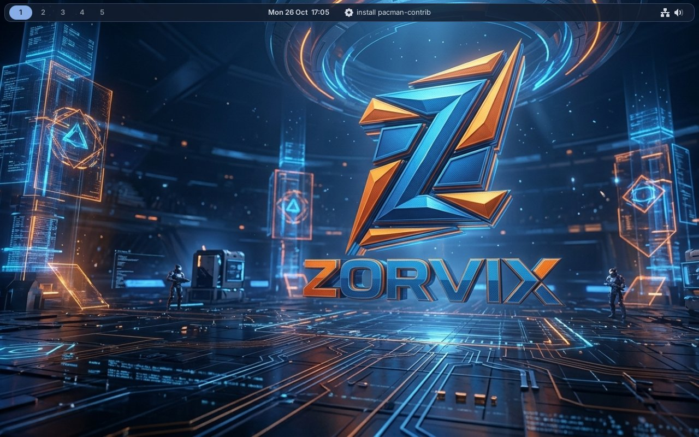
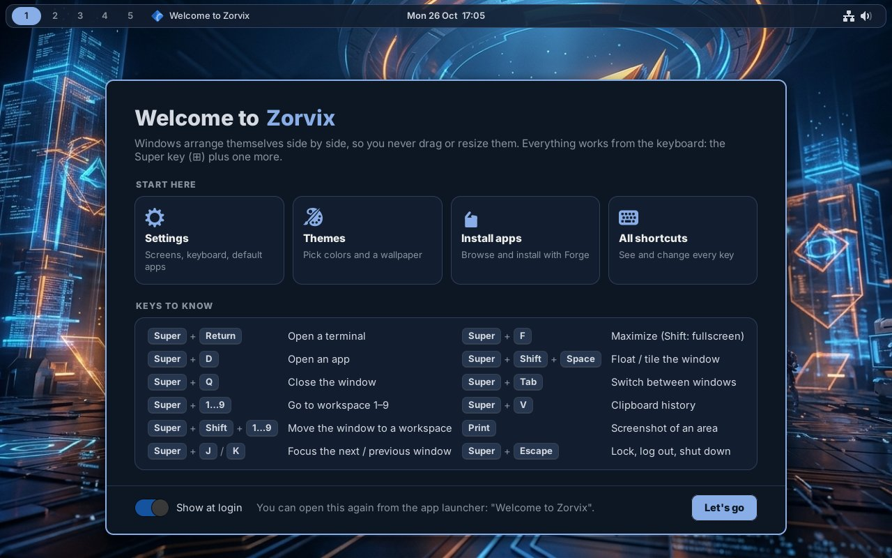

<p align="center">
  
</p>

<p align="center">
  <b>A tiling Wayland desktop for CachyOS and Arch Linux — fast, good-looking, and easy to set up.</b>
</p>

<p align="center">
  <a href="https://linuxscripthub.com/zorvix/download.html"><b>Download</b></a> ·
  <a href="https://linuxscripthub.com/zorvix/index.html">Website</a> ·
  <a href="https://linuxscripthub.com/zorvix/faq.html">FAQ</a> ·
  <a href="https://linuxscripthub.com/zorvix/config.html">Configuration</a> ·
  <a href="https://linuxscripthub.com/">LinuxScriptHub</a>
</p>

---



## What is Zorvix?

Zorvix is a complete desktop built around a tiling window manager: windows arrange themselves
side by side, so you never drag or resize them, and everything works from the keyboard. It
comes with its own bar, app launcher, notifications, lock screen, settings app and app
installer, all following one theme.

- **Tiling that stays out of your way:** a main window and a stack, with six layouts.
- **Point-and-click Settings** for nearly everything: monitors, keyboard, bar, themes, apps.
- **Themes** with matching wallpapers, and a builder that makes a theme from any picture.
- **Forge**, an app installer for the official repositories and the AUR.
- **Fast:** nothing is redrawn when nothing changes; games and videos go straight to the screen.
- **For gamers:** variable refresh rate (FreeSync / G-Sync), game mode, NVIDIA support.
- **Looks after itself:** updates set themselves up, apps reopen at login, crashed parts restart.
- **Accessible:** a screen magnifier, a high-contrast theme, bigger pointers.



## Get Zorvix

**A new computer:** download the ISO from the
[download page](https://linuxscripthub.com/zorvix/download.html), put it on a USB stick and
install. It installs CachyOS with Zorvix ready to use.

**Already on Arch Linux or CachyOS:**

```sh
curl -fsSL https://github.com/jofr27/zorvix/releases/download/repo/zorvix-repo | sudo sh
sudo pacman -S zorvix
```

Then pick Zorvix on the login screen.

**Updates** come with the rest of the system: `sudo pacman -Syu`, or Forge → Updates.

## About this repository

This repository hosts Zorvix's update files: every Zorvix computer downloads its updates from
[Releases → repo](https://github.com/jofr27/zorvix/releases/tag/repo). The packages are signed
with the Zorvix key.

Documentation, the FAQ and the ISO are on the
[Zorvix website](https://linuxscripthub.com/zorvix/index.html). Questions and feedback are
welcome in the [LinuxScriptHub forum](https://linuxscripthub.com/).

## License

Zorvix is free software under the [MIT license](LICENSE). Made by **ThE @rChItEcT**.
